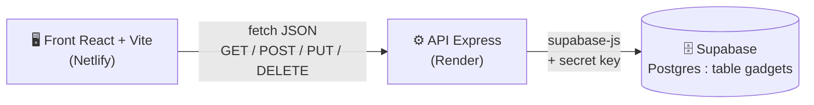

# 🕵️‍♀️ Beverly Gadgets — *L'équipement des meilleures espionnes*

Projet web ECE Paris · ING4 — boutique de gadgets d'espionnes inspirée de l'univers *Totally Spies*.
Tous les visuels (logo, modèles 3D) sont des **créations originales** : aucun asset officiel de la série.

> 👥 Organisation de l'équipe, rôles et workflow Git : voir [ORGANISATION.md](ORGANISATION.md).

---

## 1. Le pitch (30 secondes)

Les agentes de terrain ont besoin d'un équipement aussi efficace que stylé. **Beverly Gadgets** est la
boutique officielle de l'organisation : poudriers-communicateurs, rouges à lèvres laser, talons à
réaction… Chaque gadget est présenté en **3D animée** : survole la carte et le gadget s'active
(le laser s'allume, le jetpack décolle, le Compowder s'ouvre).
Côté coulisses, **Jerry** gère le stock depuis son **QG** : il ajoute des gadgets, modifie les prix
et envoie le matériel « en mission » (indisponible) d'un simple clic.

---

## 2. Architecture



```
 Navigateur                 Serveur                     Base de données
┌──────────────┐  HTTP   ┌─────────────────┐  SQL    ┌──────────────────┐
│ React (Vite) │ ──────▶ │ Express (Node)  │ ──────▶ │ Supabase         │
│ client/      │ ◀────── │ server/         │ ◀────── │ table « gadgets »│
│ Netlify      │  JSON   │ Render          │         │ (RLS activée)    │
└──────────────┘         └─────────────────┘         └──────────────────┘
  aucune clé              clé secrète dans .env
```

**Règle d'or :** le front n'appelle **jamais** Supabase directement. Il ne connaît que l'URL de
l'API (`VITE_API_URL`). La clé secrète Supabase (`sb_secret_...`) vit uniquement dans `server/.env`.

### Arborescence

```
totally-spies-shop/
├── .gitignore              # node_modules, .env, dist, .DS_Store
├── README.md
├── supabase/
│   ├── schema.sql          # création de la table + RLS
│   └── gadgets.csv         # 12 gadgets à importer
├── server/                 # API Express
│   ├── index.js            # routes
│   ├── supabaseClient.js   # LE seul endroit qui parle à Supabase
│   ├── validation.js       # validerGadget(body, { partiel })
│   ├── requetes.http       # tests de toutes les routes (200/201/204/400/404)
│   └── .env.example
└── client/                 # React + Vite + react-router-dom + three.js
    ├── public/_redirects   # pour que /qg fonctionne sur Netlify
    ├── .env.example
    └── src/
        ├── api.js          # TOUS les fetch vers l'API
        ├── useGadgets.js   # hook de chargement de la liste
        ├── pages/          # Catalogue.jsx (/) et QG.jsx (/qg)
        └── components/
            ├── FormulaireAjout.jsx, LigneGadget.jsx, CarteGadget.jsx…
            └── 3d/         # ScenePartagee, Gadget3D, modeles, materiaux
```

### Table `gadgets`

| Colonne      | Type             | Contraintes                                                        |
| ------------ | ---------------- | ------------------------------------------------------------------ |
| `id`         | int8 (identity)  | clé primaire, auto-incrémentée                                     |
| `nom`        | text             | not null                                                           |
| `prix`       | numeric          | not null, `check (prix >= 0)`                                      |
| `categorie`  | text             | Communication, Attaque, Évasion, Infiltration, Beauté-Tech         |
| `visuel`     | text             | clé du modèle 3D (`compowder`, `lipstick-laser`…)                  |
| `disponible` | boolean          | not null, défaut `true`                                            |

---

## 3. Installation locale pas à pas

Prérequis : **Node.js 18+** et un compte gratuit sur [supabase.com](https://supabase.com).

### 3.1 Créer la base Supabase

1. Sur Supabase : **New project** (choisir un nom, un mot de passe de base, la région *West EU (Paris)*).
2. Menu **SQL Editor** → **New query** → coller le contenu de [`supabase/schema.sql`](supabase/schema.sql) → **Run**.
3. Menu **Table Editor** → table `gadgets` → bouton **Insert** → **Import data from CSV** →
   choisir [`supabase/gadgets.csv`](supabase/gadgets.csv) → **Import data**.
   (Le CSV ne contient pas de colonne `id` : Postgres la génère tout seul.)
4. Récupérer les deux valeurs dont le serveur a besoin :
   - **Project URL** : *Project Settings → Data API* (forme `https://xxxx.supabase.co`) ;
   - **Secret key** : *Project Settings → API Keys → Secret keys* (commence par `sb_secret_`).
     ⚠️ Ne jamais la coller dans le front, dans un message ou dans un commit.

### 3.2 Lancer l'API

```bash
cd server
npm install
cp .env.example .env      # puis remplir SUPABASE_URL et SUPABASE_SECRET_KEY
npm run dev               # http://localhost:3000
```

Vérification : ouvrir <http://localhost:3000/gadgets> → la liste JSON des 12 gadgets s'affiche.

### 3.3 Lancer le front

Dans un **second terminal** :

```bash
cd client
npm install
cp .env.example .env      # VITE_API_URL=http://localhost:3000
npm run dev               # http://localhost:5173
```

### 3.4 Tester les routes

Ouvrir [`server/requetes.http`](server/requetes.http) dans VS Code avec l'extension **REST Client**
et cliquer sur *Send Request* au-dessus de chaque requête. Ou en ligne de commande :

```bash
curl -i http://localhost:3000/gadgets
curl -i -X POST http://localhost:3000/gadgets -H "Content-Type: application/json" -d '{"nom":"","prix":10,"categorie":"Attaque"}'
curl -i -X PUT http://localhost:3000/gadgets/99999 -H "Content-Type: application/json" -d '{"disponible":false}'
curl -i -X DELETE http://localhost:3000/gadgets/99999
```

(Respectivement : 200, 400 « Le nom du gadget est obligatoire. », 404, 404.)

---

## 4. Routes de l'API

| Méthode  | Route           | Corps attendu                                              | Succès                    | Erreurs                                                                 |
| -------- | --------------- | ---------------------------------------------------------- | ------------------------- | ----------------------------------------------------------------------- |
| `GET`    | `/`             | —                                                          | **200** message de santé  | —                                                                       |
| `GET`    | `/gadgets`      | —                                                          | **200** liste triée par id | 500 erreur Supabase                                                    |
| `POST`   | `/gadgets`      | `{ nom, prix, categorie, visuel?, disponible? }`           | **201** gadget créé       | **400** nom vide / prix absent, non numérique ou négatif / catégorie invalide · 500 |
| `PUT`    | `/gadgets/:id`  | un ou plusieurs champs (ex : `{ "disponible": false }`)    | **200** gadget modifié    | **400** mêmes règles sur les champs présents · **404** id inexistant · 500 |
| `DELETE` | `/gadgets/:id`  | —                                                          | **204** sans corps        | **404** id inexistant · 500                                             |

Toutes les erreurs sont renvoyées en JSON : `{ "erreur": "message en français" }`.

---

## 5. Déploiement (bonus)

### 5.1 API sur Render

1. Pousser le repo sur GitHub.
2. [render.com](https://render.com) → **New → Web Service** → connecter le repo.
3. Réglages :
   - **Root Directory** : `server`
   - **Runtime** : Node
   - **Build Command** : `npm install`
   - **Start Command** : `node index.js`
   - **Instance type** : Free
4. Onglet **Environment** → ajouter :
   - `SUPABASE_URL` = l'URL du projet
   - `SUPABASE_SECRET_KEY` = la secret key
   - `FRONT_URL` = l'URL Netlify (à ajouter **après** l'étape 5.2, ex : `https://beverly-gadgets.netlify.app`, sans `/` final)
   - (ne pas définir `PORT` : Render le fournit tout seul)
5. **Create Web Service**, attendre « Live », puis tester `https://<nom>.onrender.com/gadgets`.

> ℹ️ Une instance gratuite s'endort après 15 min sans visite et met ~50 s à se réveiller.
> Avant l'oral, ouvrir `https://<nom>.onrender.com/` pour la réveiller. Le front affiche
> « Connexion au QG… » puis un message d'explication pendant ce temps.

### 5.2 Front sur Netlify

1. [netlify.com](https://app.netlify.com) → **Add new site → Import an existing project** → choisir le repo.
2. Réglages :
   - **Base directory** : `client`
   - **Build command** : `npm run build`
   - **Publish directory** : `client/dist`
3. **Environment variables** → `VITE_API_URL` = `https://<nom>.onrender.com` (sans `/` final).
4. **Deploy**. Le fichier [`client/public/_redirects`](client/public/_redirects) (`/* /index.html 200`)
   permet de recharger directement la page `/qg` sans erreur 404 (react-router gère la route côté navigateur).
5. Revenir sur Render et renseigner `FRONT_URL` avec l'URL Netlify (CORS), puis **Manual Deploy**.

> ⚠️ Les variables `VITE_...` sont lues **au moment du build** : après avoir modifié
> `VITE_API_URL` sur Netlify, relancer un déploiement (*Deploys → Trigger deploy*).

---

## 6. Les visuels 3D

- Aucun fichier image ou modèle externe : chaque gadget est construit **par code** dans
  [`client/src/components/3d/modeles.jsx`](client/src/components/3d/modeles.jsx) avec des primitives
  three.js (cylindres, sphères, tores, boîtes arrondies, **extrusions** de formes 2D pour la semelle des
  talons et le boomerang).
- [`Gadget3D.jsx`](client/src/components/3d/Gadget3D.jsx) choisit le modèle grâce à la colonne `visuel`
  (modèle « gadget mystère » si la clé est inconnue), ajoute l'éclairage (`Environment` de drei +
  lumières rose/menthe), le flottement (`Float`), la rotation et l'ombre au sol (`ContactShadows`).
- **Survol** d'une carte : rotation plus rapide + effet propre au gadget (laser, grappin projeté,
  flamme des talons, lasso lumineux, brume du parfum, ondes radio, bulles d'acide, flash caméra…).
- **Gadget en mission** : palette grise et modèle immobile.
- **Performance** : un seul `<Canvas>` WebGL pour tout le site
  ([`ScenePartagee.jsx`](client/src/components/3d/ScenePartagee.jsx)) et une `<View>` drei par carte.
  Les navigateurs limitent le nombre de contextes WebGL (~16) : avec un Canvas par carte, les modèles
  disparaîtraient au-delà. Les Views hors écran ne sont pas dessinées, et la résolution (`dpr`) est
  plafonnée à 1,5 et baisse à 1 si la machine rame (`PerformanceMonitor`).

---

## 7. Préparer l'oral

**Où le serveur appelle-t-il Supabase ?**
→ Le client est créé une seule fois dans [`server/supabaseClient.js:19`](server/supabaseClient.js)
(`createClient(url, cleSecrete)`), puis utilisé dans les routes de [`server/index.js`](server/index.js) :
ligne 37 (`select` du GET), 47 (`insert` du POST), 62 (`update` du PUT), 74 (`delete` du DELETE).

**Pourquoi la clé n'est-elle pas dans le front ?**
→ Tout ce qui est dans le front (même dans un `.env` Vite) est copié dans le JavaScript envoyé au
navigateur : n'importe qui peut le lire avec F12. La secret key **contourne la RLS** et donne tous
les droits sur la base (lire, modifier, tout supprimer). Elle reste donc sur le serveur
([`server/supabaseClient.js:11`](server/supabaseClient.js) lit `process.env.SUPABASE_SECRET_KEY`), dans
`server/.env` qui n'est jamais commité.

**Que se passe-t-il avec un formulaire vide ?**
→ Le front n'empêche rien (`noValidate`) : il envoie le POST. Le serveur appelle
`validerGadget(req.body)` ([`server/index.js:44`](server/index.js)), la règle du nom
([`server/validation.js:21-23`](server/validation.js)) échoue → réponse **400**
`{ "erreur": "Le nom du gadget est obligatoire." }` ([`server/index.js:45`](server/index.js)).
Côté React, `api.js` transforme ce 400 en exception, attrapée par le `catch` de
[`FormulaireAjout.jsx:32`](client/src/components/FormulaireAjout.jsx) qui affiche le message en rouge.
Rien n'est inséré en base.

**Où est le `useState` du formulaire et que fait son setter ?**
→ [`client/src/components/FormulaireAjout.jsx:13`](client/src/components/FormulaireAjout.jsx) :
`const [formulaire, setFormulaire] = useState(FORMULAIRE_VIDE)`. C'est un formulaire **contrôlé** :
chaque `<input>` affiche `formulaire.xxx`, et à chaque frappe `handleChange` (ligne 19) appelle
`setFormulaire({ ...formulaire, [e.target.name]: e.target.value })` : on copie l'objet en remplaçant
le seul champ modifié. Le setter remplace l'état et **déclenche un nouveau rendu** du composant avec
la nouvelle valeur. Après un ajout réussi, `setFormulaire(FORMULAIRE_VIDE)` (ligne 30) vide le formulaire.

**Pourquoi le front passe-t-il par l'API au lieu d'appeler Supabase ?**
→ 1) **Sécurité** : la clé reste côté serveur. 2) **Validation** : les règles métier
([`validation.js`](server/validation.js)) sont appliquées au même endroit pour tout le monde, impossible
de les contourner depuis le navigateur. 3) **Découplage** : le front ne connaît que 4 routes
([`client/src/api.js`](client/src/api.js)) ; on pourrait changer de base sans toucher au React.
C'est l'architecture imposée : React → Express → Supabase.

**À quoi sert le `.gitignore` ?**
→ [`.gitignore`](.gitignore) liste les fichiers que Git ne doit jamais suivre : `node_modules/`
(dépendances, très lourdes, réinstallées avec `npm install`), **`.env`** (les secrets !), `dist/`
(build généré) et `.DS_Store` (fichiers macOS). Il a été créé **avant le premier commit**, sinon
un `.env` déjà commité resterait dans l'historique même après suppression.

---

## 8. Bug rencontré et résolu

**Symptôme :** `PUT /gadgets/99999` (id inexistant) renvoyait **200** au lieu de 404.

**Cause :** sans `.select()`, `supabase.from('gadgets').update(...).eq('id', id)` ne renvoie aucune
ligne (`data` vaut `null`) et **aucune erreur** : pour Postgres, un `UPDATE` qui ne touche aucune ligne
n'est pas une erreur. Le serveur ne pouvait donc pas distinguer « modifié » de « n'existe pas ».

**Correction** ([`server/index.js:62-64`](server/index.js)) : on ajoute `.select()` pour que Supabase
renvoie les lignes réellement modifiées, puis on teste le tableau :

```js
const { data, error } = await supabase.from('gadgets').update(donnees).eq('id', id).select()
if (error) return erreurServeur(res, error)
if (data.length === 0) return res.status(404).json({ erreur: `Aucun gadget avec l'id ${id}.` })
```

Même technique pour le `DELETE` (ligne 74-76). Bonus : le PUT renvoie maintenant l'objet modifié,
ce qui permet au front de mettre à jour sa liste sans tout recharger.

**Deuxième piège (front) :** le `DELETE` répond **204 No Content**, donc sans corps. Appeler
`res.json()` dessus provoque `SyntaxError: Unexpected end of JSON input`. Solution dans
[`client/src/api.js:22`](client/src/api.js) : `if (res.status === 204) return null` avant le `res.json()`.

---

## Stack

React 19 · Vite · react-router-dom · three.js · @react-three/fiber · @react-three/drei ·
Express 5 · @supabase/supabase-js · dotenv · cors · Supabase (Postgres)
